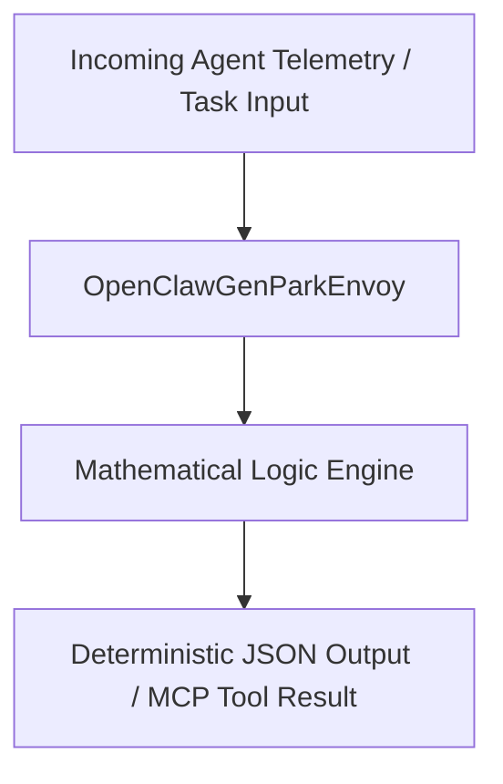

# openclaw-genpark-envoy

[](https://github.com/Alpha-Park)
[](https://modelcontextprotocol.io)
[](requirements.txt)
[](#)
[](#)
[](LICENSE)

OpenClaw GenPark agent skill with a standard-library core client and an MCP SDK server. Provides high-throughput deterministic execution, cryptographic security, and quantitative analysis via the Model Context Protocol (MCP).

---

## Architecture & Data Flow



---

## MCP Runtime Requirements

Use Python 3.10+ for the MCP server. The core `client.py` has no external dependencies; MCP transport requires `mcp>=1.0.0,<2`. From this checkout, install it into the Python environment used by your MCP client:

```bash
python -m pip install -r requirements.txt
```

Use the same Python interpreter to launch `mcp_server.py`. In desktop client configuration, set `command` to that interpreter's absolute path.

## Quickstart & Usage

### 1. Direct Python Client Execution
```bash
python example_usage.py
```

### 2. Standalone MCP Server Launch
Run the MCP SDK server over STDIO:
```bash
python mcp_server.py
```

---

## License

This project is licensed under the MIT License - see the [LICENSE](LICENSE) file for details.
